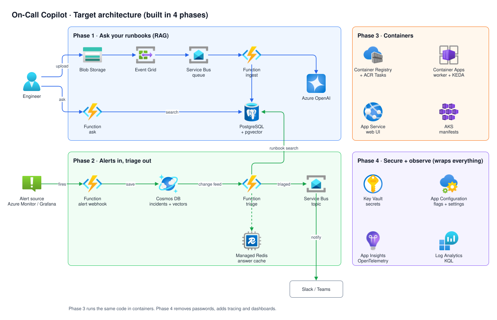

# On-Call Copilot

**Ask your runbooks what to do when something breaks.**

Upload your team's runbooks as Markdown files. On-Call Copilot reads them, and when you ask a question, like *"Payments API latency is above 2 seconds, what should I check?"*, it answers with steps and tells you which runbook each step came from.

It's built on Azure, one phase at a time, while I prepare for the **Microsoft AI-200** exam. Every phase is a working app you can deploy.



## Roadmap

| Phase | What it adds | Azure services | Status |
|---|---|---|---|
| 1 | Ask your runbooks (RAG) | Blob Storage, Event Grid, Service Bus, Functions, PostgreSQL + pgvector, Azure OpenAI | ✅ Working |
| 2 | Alerts come in, a triage goes out to Slack/Teams | Cosmos DB (vectors + change feed), Managed Redis, Service Bus topics | ⏳ Planned |
| 3 | Run it in containers, plus a web UI | Container Registry + Tasks, Container Apps + KEDA, App Service, AKS | ⏳ Planned |
| 4 | Production-ready | Key Vault, App Configuration, OpenTelemetry, KQL, "Deploy to Azure" button | ⏳ Planned |

How Phase 1 works, step by step: [docs/phase-1.md](docs/phase-1.md)

## Try it (Phase 1)

**You need:** an Azure subscription, [Azure CLI](https://learn.microsoft.com/cli/azure/install-azure-cli), [Azure Functions Core Tools v4](https://learn.microsoft.com/azure/azure-functions/functions-run-local) and Python 3.12.

**1. Create a resource group**

```bash
az login
az group create --name rg-oncall-copilot --location eastus2
```

**2. Create the Azure resources** (takes about 10 minutes)

```bash
az deployment group create \
  --resource-group rg-oncall-copilot \
  --template-file infra/main.bicep \
  --parameters pgAdminPassword='<a-strong-password-without-spaces>'
```

Got `SkuNotAvailable` for PostgreSQL? Your subscription can't use B1ms in that region. Run the same command again and add `pgSku=Standard_B2s` (a slightly bigger size), or `pgLocation=<another-region>`, after the password.

**3. Deploy the code**

```bash
FUNC=$(az deployment group show --resource-group rg-oncall-copilot --name main \
  --query properties.outputs.functionAppName.value --output tsv)

cd src/functions && func azure functionapp publish $FUNC --python && cd ../..
```

**4. Upload the sample runbooks**

```bash
STORAGE=$(az deployment group show --resource-group rg-oncall-copilot --name main \
  --query properties.outputs.storageAccountName.value --output tsv)

az storage blob upload-batch --account-name $STORAGE --destination runbooks \
  --source samples/runbooks --auth-mode key
```

**5. Ask a question**

```bash
ASK_URL=$(az deployment group show --resource-group rg-oncall-copilot --name main \
  --query properties.outputs.askUrl.value --output tsv)
KEY=$(az functionapp keys list --resource-group rg-oncall-copilot --name $FUNC \
  --query functionKeys.default --output tsv)

curl --request POST "$ASK_URL?code=$KEY" \
  --header "Content-Type: application/json" \
  --data '{"question": "Payments API latency is above 2 seconds. What should I check?"}'
```

Add `"service": "payments-api"` to the JSON to search only that service's runbooks.

**Use your own runbooks:** upload Markdown files as `runbooks/<service-name>/<file>.md`. The folder name becomes the service name.

**Clean up** when you're done, so it stops costing money:

```bash
az group delete --name rg-oncall-copilot
```

## Repo layout

```
infra/main.bicep        All Azure resources (Infrastructure as Code)
src/functions/          Python Azure Functions: ingest + ask
samples/runbooks/       Example runbooks to try it with
docs/                   Phase guides, diagrams, journey log, blog plan
```

## Follow along

- [Journey log](docs/JOURNEY.md): what I built, what broke and what I learned
- [Blog plan](docs/BLOG-PLAN.md): the posts this project turns into
- Diagrams are `.drawio.svg` files. GitHub shows them as images, and you can open them in [draw.io](https://app.diagrams.net) to edit.

## License

MIT. Use it, fork it, and adapt it for your team.
