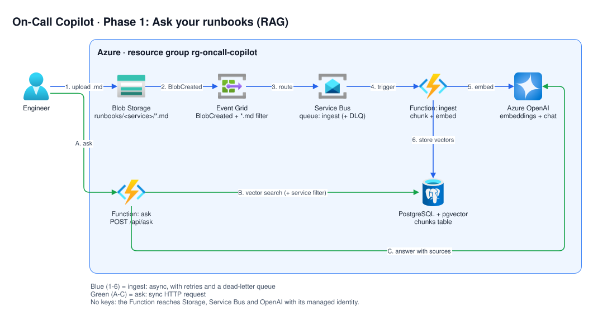

# Phase 1: Ask your runbooks

**Goal:** upload Markdown runbooks, then ask questions and get answers with sources.

## How it works

**Ingest flow (blue, runs in the background)**

1. You upload `runbooks/payments-api/high-latency.md` to Blob Storage.
2. Storage raises a `BlobCreated` event.
3. Event Grid checks its filter (only `.md` files in `runbooks/`) and puts the event on a Service Bus queue.
4. The queue triggers the `ingest` Function.
5. The Function splits the file into chunks and turns each chunk into a vector with Azure OpenAI.
6. The chunks and vectors are saved in PostgreSQL (pgvector).

If any step fails, Service Bus retries the message. After 5 failures it moves the message to the **dead-letter queue**, so nothing is lost silently.

**Ask flow (green, a normal HTTP request)**

- **A.** You send `POST /api/ask` with a question.
- **B.** The Function turns the question into a vector and finds the 5 closest chunks, optionally only for one service.
- **C.** Azure OpenAI writes an answer from those chunks, and the response lists the sources.

## Why each piece is there

| Piece | Why not something simpler? |
|---|---|
| Event Grid | Storage tells us about new files, so nothing has to keep checking for them. The filter skips files we don't care about. |
| Service Bus | A buffer with retries and a dead-letter queue. If OpenAI is slow or down, uploads still aren't lost. |
| pgvector | Vector search inside ordinary Postgres, so metadata filters are just a `WHERE` clause. |
| Managed identity | The Function uses no keys for Storage, Service Bus or OpenAI. OpenAI keys are turned off completely. |

## AI-200 skills covered

- **Azure Database for PostgreSQL:** schema, indexes (HNSW), vector search, RAG with a metadata filter
- **Azure Service Bus:** queues and dead-letter handling
- **Azure Event Grid:** system topics, filters, retries
- **Azure Functions:** triggers and bindings (Service Bus, HTTP), deploying a function app
- **Infrastructure as Code:** Bicep, managed identity and role assignments

## Hands-on experiments (good exam practice)

1. **Fill the dead-letter queue.** Upload a `.md` file that isn't UTF-8, such as a renamed image. Watch it retry 5 times, then find it in the DLQ in the portal (Service Bus → `ingest` → Service Bus Explorer → Dead-letter).
2. **Test the Event Grid filter.** Upload a `.txt` file. Nothing should happen. Why?
3. **Re-upload a runbook.** Edit a file and upload it again. The old chunks are replaced, not duplicated.
4. **Filter by service.** Ask the same question with and without `"service"` and compare the `sources`.
5. **Read the logs with KQL.** In Application Insights → Logs, run: `traces | where message startswith "Ingested" | order by timestamp desc`

## Known shortcuts (fixed in later phases)

- The Postgres password is stored in an app setting. Phase 4 moves it to Key Vault.
- A new database connection is opened for every request. Phase 3 adds connection pooling.
- Postgres allows access from Azure services instead of using a private network.
